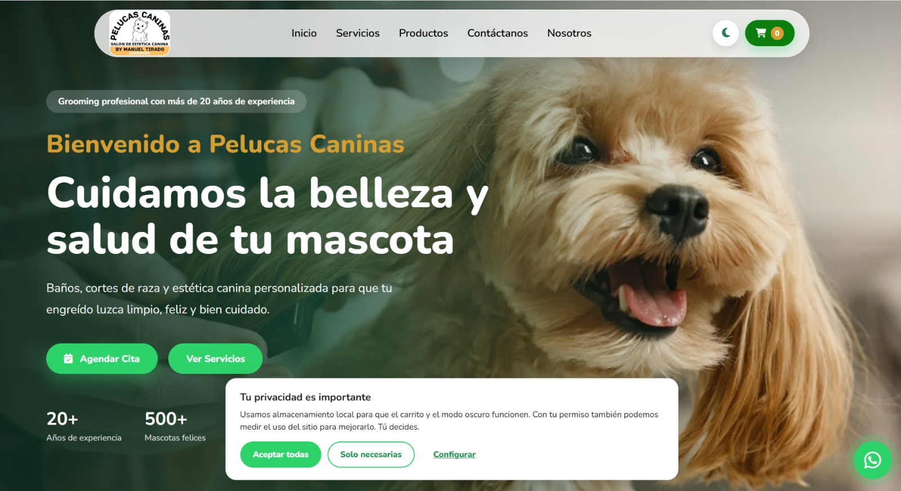
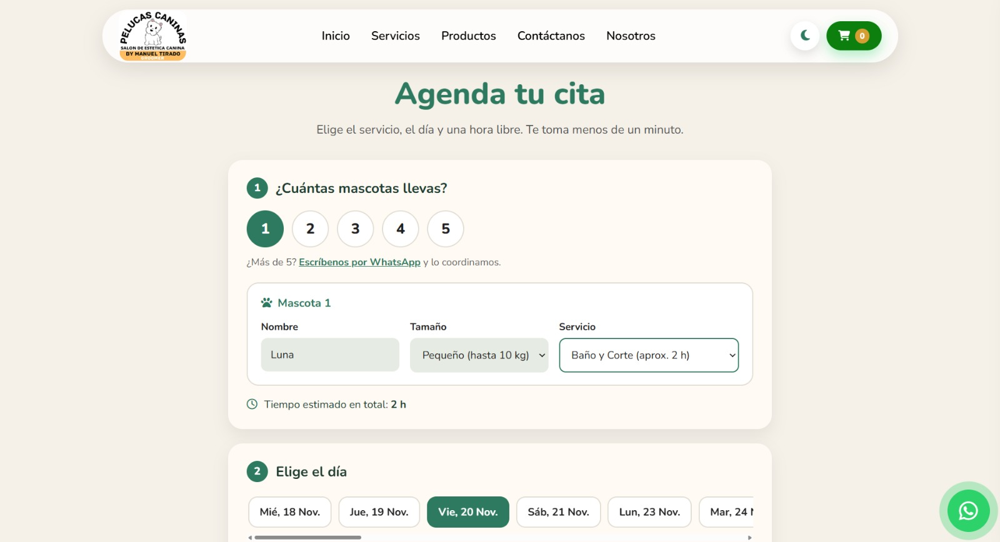
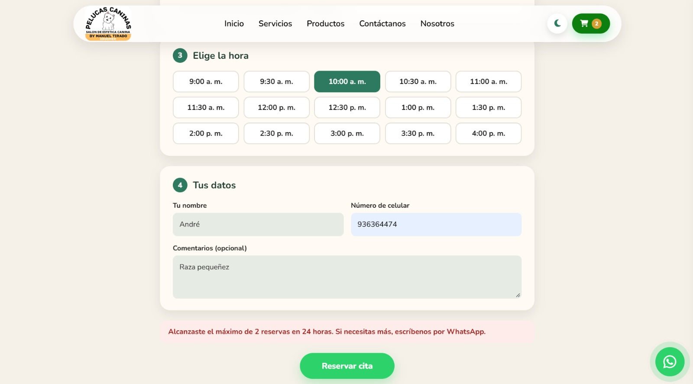
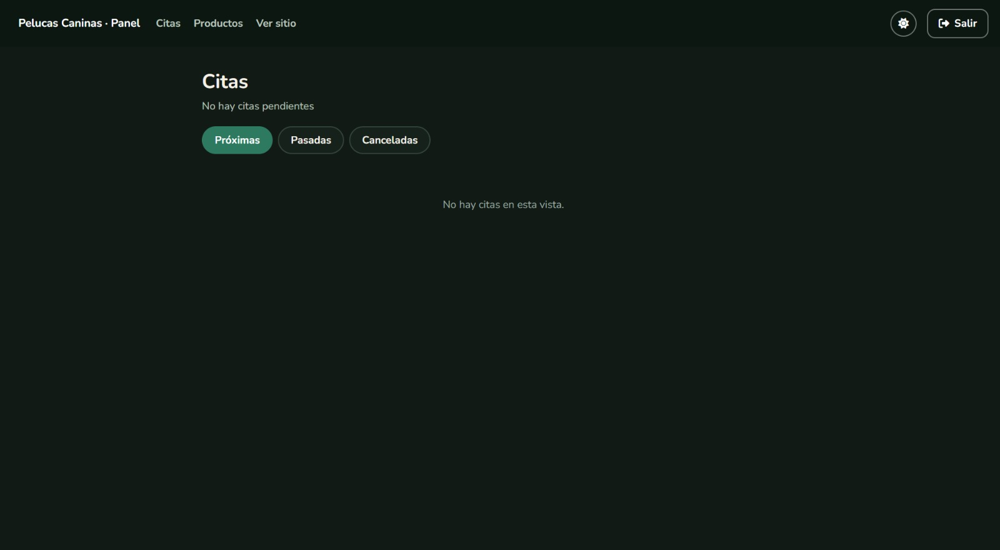
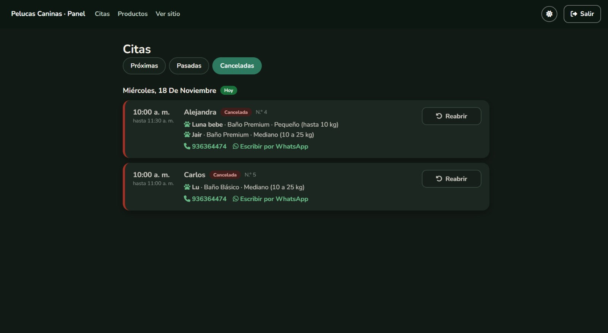
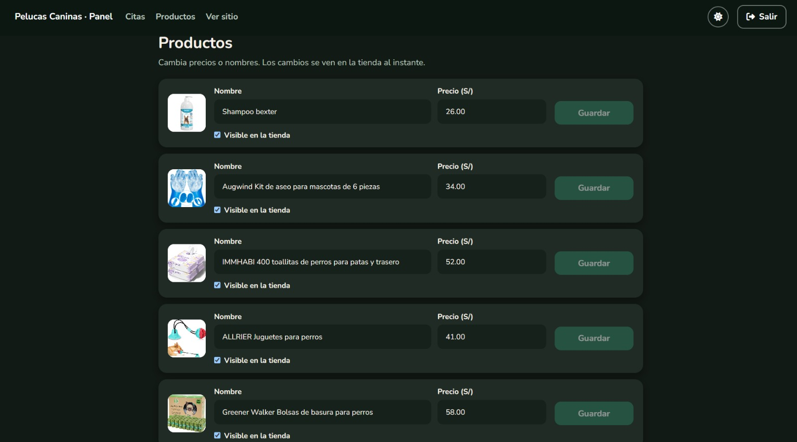
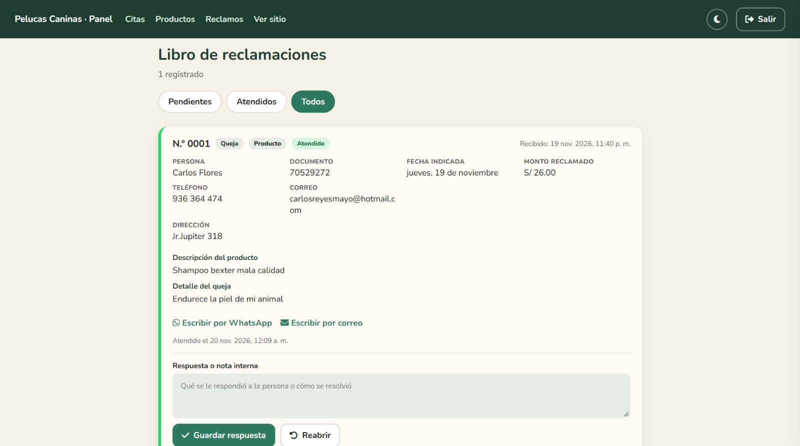

# 🐾 Pelucas Caninas

Aplicación web full stack para **Pelucas Caninas**, peluquería canina en San Juan de Lurigancho (Lima, Perú): catálogo y tienda, reserva de citas en línea y panel de administración para el dueño.

**Demo en vivo:** https://pelucas-caninas.vercel.app

Proyecto de portafolio basado en un negocio real, realizado con autorización del dueño. Evolucionó desde un sitio estático en HTML, CSS y JavaScript hasta una aplicación con base de datos, autenticación y despliegue automático.

## Capturas

### Sitio público



### Reserva de citas




### Panel de administración






## Stack

- **Next.js** (App Router) + **React** + **TypeScript**
- **PostgreSQL** (Neon) con **Drizzle ORM**
- **Zod** para validar los datos en el servidor
- CSS propio, con modo oscuro y diseño responsive
- **Vercel** para el despliegue, con publicación automática en cada `git push`

## Funcionalidades

### Sitio público

- Catálogo con búsqueda en vivo y página de detalle por producto
- Carrito persistente; el pedido sale por WhatsApp con el detalle y el total ya escritos
- Servicios, galería con ampliación de imagen y carrusel de productos relacionados
- Modo oscuro sin parpadeo al cargar
- Aviso de cookies con *Aceptar todas*, *Solo necesarias* y configuración por categorías; el consentimiento queda guardado y se puede cambiar desde el pie de página
- Libro de reclamaciones (formulario con validación)
- SEO: metadatos por página, datos estructurados (JSON-LD) en los productos y `robots.txt`

### Reserva de citas

- Servicio por mascota, día y hora libre
- Varias mascotas por reserva (hasta 5), cada una con su nombre, tamaño y servicio
- Los horarios se calculan según el tiempo de cada servicio y la **capacidad real del salón** (peluqueros trabajando a la vez)
- Evita reservas duplicadas, incluso si dos personas reservan al mismo tiempo
- Al terminar, abre WhatsApp con el resumen de la reserva ya escrito

### Panel de administración (solo el dueño)

- Acceso con usuario y contraseña en `/admin`
- Citas agrupadas por día, con filtros de próximas, pasadas y canceladas
- Confirmar, cancelar y reabrir citas; al reabrir, verifica que el horario siga libre
- Mensaje de confirmación para el cliente listo para enviar por WhatsApp
- Editar nombre y precio de los productos, u ocultarlos de la tienda; los cambios se ven al instante
- Modo claro y oscuro propios

### Seguridad

- Contraseña del panel guardada solo como huella cifrada (scrypt)
- Sesión firmada en una cookie `HttpOnly`
- Comprobación de sesión en cada página y en cada ruta de la API protegida
- Verificación de origen en las peticiones que modifican datos
- Bloqueo temporal tras 5 intentos fallidos de acceso
- Máximo de 2 reservas cada 24 horas por número de celular y por IP; la IP solo se guarda como huella cifrada
- Campo trampa contra bots y validación de todos los datos en el servidor
- `/admin` y `/api` fuera de los buscadores

## Qué cambió respecto a la versión estática

| Antes | Ahora |
|---|---|
| 11 archivos HTML casi idénticos, uno por producto | 1 página dinámica `/productos/[slug]` |
| Navbar y footer copiados en cada archivo | Componentes reutilizables |
| Precios y productos escritos a mano en el HTML | Tabla `productos` en PostgreSQL |
| Pedidos y citas solo por mensaje de WhatsApp | Reservas guardadas en la base de datos, con panel de gestión |
| Teléfono y correo escritos en el código | Variables de entorno |
| Imágenes PNG de hasta 2,8 MB | WebP optimizado |
| Sin SEO | Metadatos, JSON-LD y `robots.txt` |

## Hoja de ruta

- [x] Migración a Next.js y TypeScript
- [x] Base de datos y catálogo dinámico
- [x] Sistema de citas con horarios, capacidad y varias mascotas
- [x] Panel de administración con login
- [x] Despliegue en producción (Vercel + Neon)
- [ ] Guardar los reclamos del libro de reclamaciones en la base de datos
- [ ] Crear productos nuevos y subir fotos desde el panel
- [ ] Cerrar días o cambiar el número de peluqueros desde el panel
- [ ] Dominio propio

## Ejecutar en local

Requisitos: Node.js 20 o superior y una base PostgreSQL (con Docker, o gratis en [Neon](https://neon.tech)).

```bash
npm install
cp .env.example .env.local      # completa tus datos
docker compose up -d            # solo si usas PostgreSQL local con Docker
npm run db:setup                # crea las tablas y carga los productos
npm run dev                     # http://localhost:3000
```

En Windows, en lugar de `cp` puedes copiar el archivo `.env.example` y renombrarlo a `.env.local`.

### Variables de entorno

| Variable | Uso |
|---|---|
| `DATABASE_URL` | Conexión a PostgreSQL |
| `NEXT_PUBLIC_WHATSAPP` | Número de WhatsApp con código de país y sin `+` |
| `NEXT_PUBLIC_EMAIL` | Correo de contacto que se muestra en el pie de página |
| `NEXT_PUBLIC_SITE_URL` | URL pública del sitio |
| `ADMIN_USER` | Usuario del panel de administración |
| `ADMIN_PASSWORD_HASH` | Huella cifrada de la contraseña; se genera con `npm run admin:clave` |
| `AUTH_SECRET` | Clave para firmar la sesión (mínimo 32 caracteres); la genera el mismo comando |
| `LIMITE_RESERVAS` | Opcional. Con el valor `off` desactiva el límite de 2 reservas por día, útil solo para probar en local |

### Scripts

| Comando | Qué hace |
|---|---|
| `npm run dev` | Servidor de desarrollo |
| `npm run build` | Compila para producción |
| `npm run start` | Sirve la compilación de producción |
| `npm run db:push` | Crea o actualiza las tablas en la base de datos |
| `npm run db:seed` | Carga los productos iniciales |
| `npm run db:setup` | Ejecuta `db:push` y `db:seed` |
| `npm run db:reset-citas` | Borra las tablas de citas (pide confirmación) |
| `npm run admin:clave` | Genera las credenciales del panel de administración |
| `npm test` | Ejecuta las pruebas automáticas |

## Panel de administración

1. Ejecuta `npm run admin:clave`, elige un usuario y una contraseña de al menos 10 caracteres, y copia las 3 líneas que imprime en `.env.local`.
2. Reinicia el servidor y entra a `/admin`.

No hay ningún enlace al panel en la web pública; se accede escribiendo la dirección `/admin`.

## Pruebas

```bash
npm test
```

Las pruebas automáticas cubren los horarios y la capacidad del salón, la sesión firmada y las contraseñas, el límite de reservas por IP y celular, el formato del mensaje de confirmación y la validación de la cadena de conexión.

## Despliegue

El proyecto se publica en **Vercel**, conectado a este repositorio: cada `git push` a la rama `main` genera un despliegue nuevo de forma automática. La base de datos está en **Neon**, y el archivo `vercel.json` fija la región de las funciones en São Paulo para que estén cerca de la base.

Variables necesarias en Vercel: las de la tabla anterior, excepto `LIMITE_RESERVAS`. Las que empiezan con `NEXT_PUBLIC_` se incorporan al construir la web, así que al cambiarlas hay que volver a desplegar.

## Estructura

```
src/
  app/            páginas y rutas: inicio, servicios, productos, nosotros, libro,
                  agendar, admin y API
  components/     navbar, footer, carrito, cookies, formulario de citas, panel
  db/             esquema, consultas, validación de la conexión y carga inicial
  lib/            horarios, autenticación, límites, mensajes y utilidades
  styles/         hojas de estilo
scripts/          generador de credenciales del administrador
data/             productos iniciales
public/img/       imágenes optimizadas
vercel.json       configuración de despliegue
```
